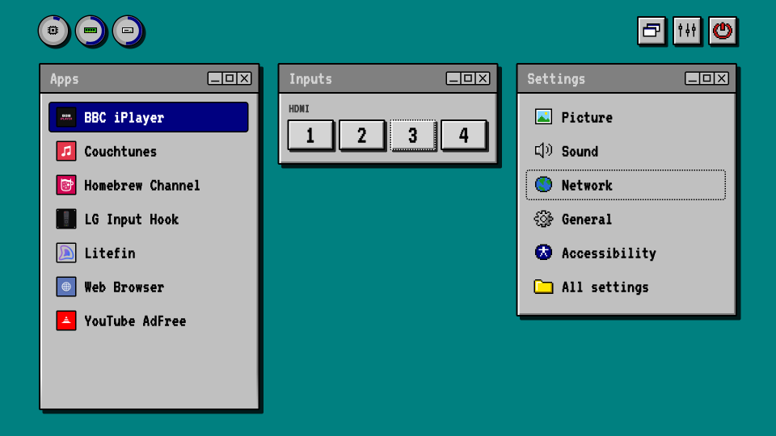
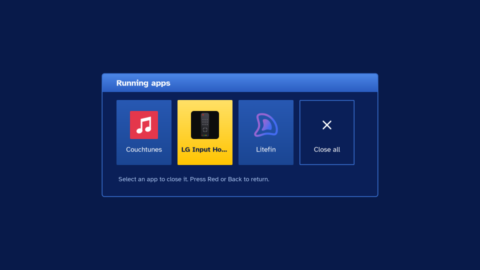
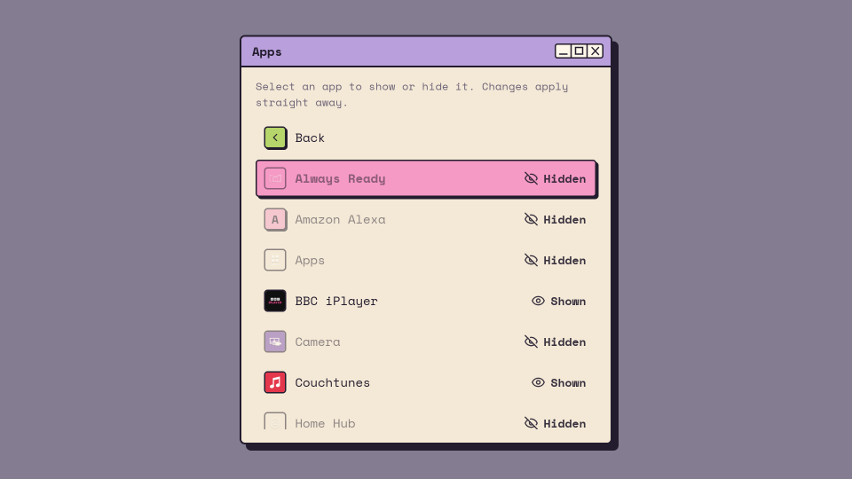

# webos-homescreen

A plain home screen for rooted LG webOS TVs: your apps, your HDMI inputs and the settings you actually use, with no ads, rows of recommendations or sponsored tiles.

It's a normal web app. You open it like any other app, or, optionally and experimentally, it can take over LG's Home button (see [Replacing LG Home](#replacing-lg-home-experimental)).


| Satellite | Retro | Desktop |
|---|---|---|
|  |  |  |

| Running apps (Red) | Themes (Green) | Customise > Apps |
|---|---|---|
|  |  |  |

## What it does

Three columns:

| Apps | Inputs | Settings |
|---|---|---|
| Installed apps with their icons, with a hide list | HDMI 1–4 as tiles | Picture, Sound, Network, General, Accessibility, All settings. Each opens the matching page of LG's settings app |

Along the top:
- **Gauges**: CPU, memory and storage as rings, refreshed every 5 s while the screen is visible.
- **Running apps**: list the open apps and close any of them. The **Red** button opens and closes it from anywhere.
- **Customise**: show or hide apps, and pick a theme. The **Green** button opens Themes directly.
- **Power**: Screen off, Reboot, Power off. Reboot and Power off need a second press within 2 s.

Themes: Classic (default, flat), Dusk, Harbour, Woodland, Retro (90s desktop), Desktop (95-style, pixel icons), Poster (giant type), Satellite (noughties set-top planner).

Navigation works with both the D-pad and the Magic Remote pointer (hover and click). Back closes any open panel.

## Requirements

- A **rooted** LG webOS TV with [Homebrew Channel](https://github.com/webosbrew/webos-homebrew-channel) (root status "ok").
- Tested on an LG C2 OLED, webOS 24 (webOS TV 9.2.2), software 23.25.55. Other models and versions should work for the app itself, but haven't been tested.

Root is needed because these features use Homebrew Channel's root `exec` service:
- app icons (copied into the app's own `icons/` folder, since a web app can't read other apps' folders)
- the gauges (`/proc/stat`, `/proc/meminfo`, `df`)
- the power menu (the sleep and power services refuse calls from a normal app)
- saving your choices to `/media/developer/homescreen-settings.json`, so they survive a reinstall

Without root the columns still work, but icons, gauges, power and saved choices don't.

## Install

Download the `.ipk` from [Releases](../../releases), or build it yourself:

```sh
npm install -g @webos-tools/cli
ares-package app/
```

Install on the TV, as root over SSH:

```sh
scp io.github.file48.homescreen_*.ipk root@TV_IP:/tmp/homescreen.ipk
ssh root@TV_IP 'luna-send -i luna://com.webos.appInstallService/dev/install "{\"id\":\"com.ares.defaultName\",\"ipkUrl\":\"/tmp/homescreen.ipk\",\"subscribe\":true}" </dev/null'
```

Press Ctrl-C once it reports `installed`. The app is listed as **Home**.

You can also install it with Homebrew Channel or `ares-install` if you use Developer Mode.

### ⚠️ Uninstalling can log you out of every web app

On the test TV (webOS 24), uninstalling this app, or any other developer-installed web app, with `appInstallService/dev/remove` wiped the shared web app storage folder, `/var/lib/wam/Default` (Local Storage and IndexedDB). Every web app lost its saved data, so Jellyfin clients, YouTube and so on were all logged out. The installer logs this as its `removing data` step. There's no documented way to make it skip that.

So, if you want to stop using the launcher:
- Prefer leaving it installed and just not opening it. If you use the takeover, switch it off with `home-takeover.sh off`.
- If you must remove it, be ready to log in to your other web apps again. Backing up `/var/lib/wam/Default` first and restoring it afterwards, with the web app manager stopped, may avoid this, but it hasn't been tested.


## Configure

Edit `app/config.js` before packaging. It controls:
- the inputs column
- the settings rows
- the top-bar buttons
- the power commands
- the Red and Green key codes (403 and 404)
- the gauges and their refresh interval
- the default hide list (`hideApps`)

Customise > Apps on the TV overrides the hide list per app.

## Replacing LG Home (experimental)

`takeover/` makes LG's Home button open this launcher instead of LG's home screen. **Read this whole section first.** It depends on LG's internal file layout and boot behaviour, and it has only been tested on one TV (LG C2, webOS 24 9.2.2, software 23.25.55).

### How it works

LG Home is a native Qt/QML app restored at boot from a CRIU snapshot. `home-takeover.sh on` does four things:
1. It copies `MainView.qml` to RAM and bind-mounts it over LG Home's `qml/UserInterfaceLayer/Containers/MainView_M.qml`. Nothing on disk is changed.
2. It stops LG Home and asks the app manager to launch it again, so it restores from its snapshot and loads the replacement view.
3. The replacement view is a black screen. It opens this launcher, through LG Home's own `launchApp`, whenever Home becomes active.
4. If `[homescreen] replacement main view loaded` doesn't appear in `/var/log/home` within 15 s, it undoes the mount and brings stock Home back.

`boot.sh` re-applies this at every boot from a Homebrew Channel startup hook. LG's own home screen still shows for the first ~25 s of a cold boot, until Homebrew Channel's startup scripts run. Removing that wasn't possible with any known hook.

### Install

```sh
scp -r takeover root@TV_IP:/media/developer/home-takeover
ssh root@TV_IP 'sh /media/developer/home-takeover/home-takeover.sh on'
```

It should print `applied`. Then press Home from an app and from an HDMI input, and use the TV for a while. To apply it at every boot:

```sh
ssh root@TV_IP 'sh /media/developer/home-takeover/home-takeover.sh persist'
```

That links `/var/lib/webosbrew/init.d/40-homescreen` to `boot.sh`.

### Undo

```sh
ssh root@TV_IP 'sh /media/developer/home-takeover/home-takeover.sh off'   # unmounts, restores LG Home, removes the boot link
ssh root@TV_IP 'sh /media/developer/home-takeover/home-takeover.sh status'
```

Other ways out:
- **Skip it for one boot:** `mv /media/developer/home-takeover/enabled /media/developer/home-takeover/enabled.off`, then reboot. Rename it back afterwards.
- **Failsafe:** if a boot-time takeover starts but never finishes (for example the TV was power-cycled on a black screen), the next boot switches the takeover off and leaves LG Home alone.
- **Nothing persists outside `/media/developer` and the init.d link.** A reboot without the hook gives you stock LG Home.

### Warnings

- **Never mark LG Home's CRIU snapshot invalid** (an `invalid_img` file in `/mnt/lg/cmn_data/checkpoint/com.webos.app.home/`). On the test TV, LG Home then didn't start at all: black screen, and app launches stalled. To recover, remove that file (and `/tmp/checkpoint/com.webos.app.home/invalid_img`), then reboot.
- SSH (Homebrew Channel) only starts ~24 s into boot. If something breaks the app manager before that, you may not get a shell. That's why the takeover runs late, is RAM-only, and has the failsafe.
- On other firmware, the main view may have a different file name or LG's controller may expect different members. The script checks the target file exists and rolls back if the view isn't seen loading, but it can't foresee every difference.

## Notes

- The app ID is `io.github.file48.homescreen`. If you change it, change `selfId` in `config.js` and `LAUNCHER_ID` in the takeover scripts too.
- Choices are kept in the page's `localStorage` (for a fast start) and in `/media/developer/homescreen-settings.json`. The file wins when they differ.
- Only theme IDs from the list, app IDs matching a strict pattern, and 0/1 values ever reach the shell command that writes the settings file.

## Credits

- Icons: [Lucide](https://lucide.dev) (ISC licence, `app/LICENSE-lucide.txt`). The Desktop theme's pixel icons were drawn for this project.
- Fonts, all under the SIL Open Font License 1.1 (licence files in `app/fonts/`): Atkinson Hyperlegible, Bricolage Grotesque, Space Mono, Syne, VT323.
- The compatibility stand-ins and lifecycle handling in `takeover/MainView.qml` are adapted from [webos-home](https://github.com/Mr-Neutr0n/webos-home) by Mr-Neutr0n (MIT, Copyright (c) 2026 webOS Home contributors; `takeover/LICENSE-webos-home.txt`).

Built with AI assistance (Claude).

## Disclaimer

Use at your own risk. Rooting and modifying your TV may void the warranty. This project isn't affiliated with LG Electronics.

## License

MIT (see `LICENSE`), except the bundled icons and fonts, which keep their own licences.
