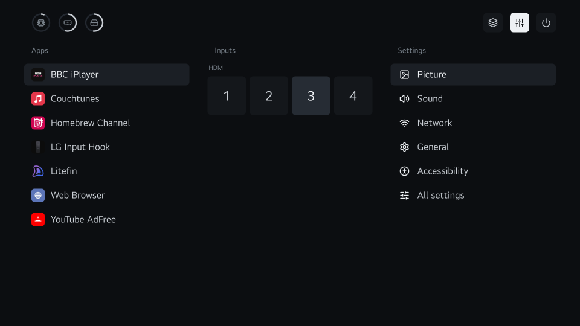
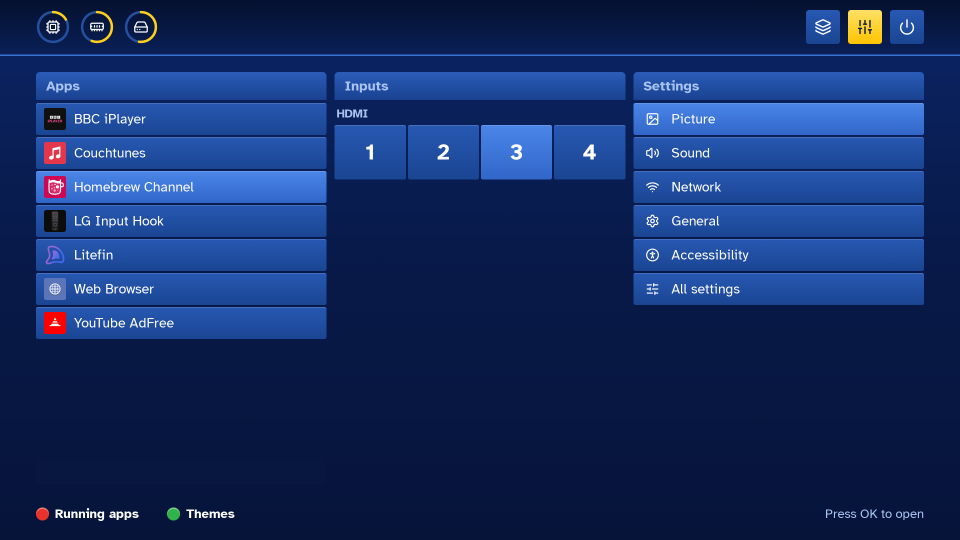
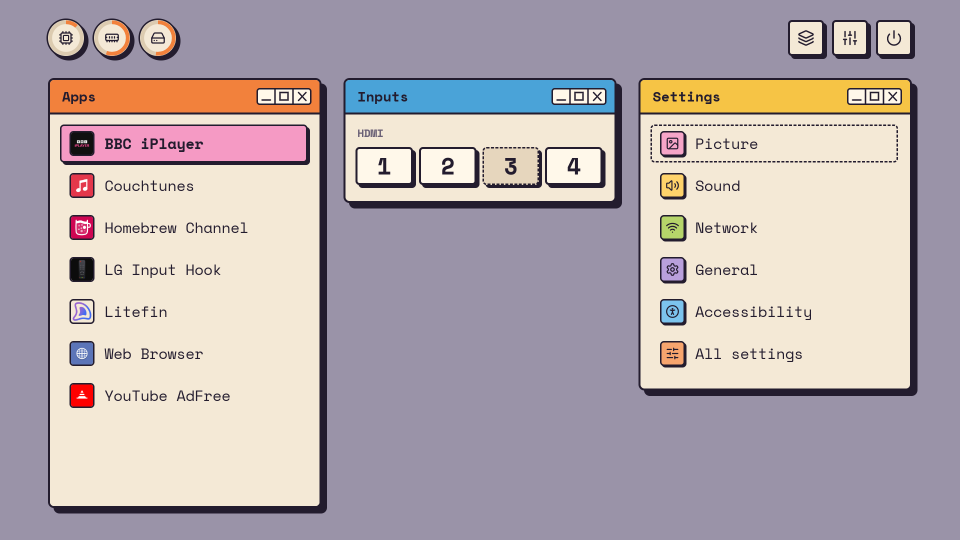
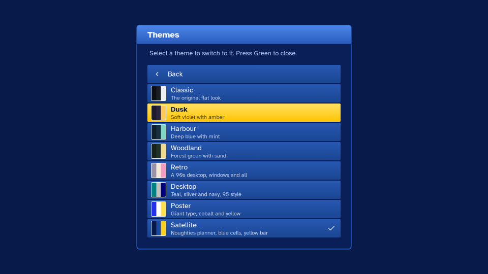

# webos-homescreen

A plain home screen for rooted LG webOS TVs: your apps, HDMI inputs and settings, with no ads or recommendations.



| Satellite | Retro | Desktop |
|---|---|---|
|  |  |  |

| Running apps | Themes | Show or hide apps |
|---|---|---|
|  |  |  |

## Features

- Three columns: apps (with a hide list), HDMI 1–4, and shortcuts into LG's settings
- CPU, memory and storage gauges
- Running-apps tray (**Red** button) to close apps
- Eight themes (**Green** button)
- Screen off, reboot and power off
- D-pad and Magic Remote pointer

## Requirements

A rooted LG webOS TV with [Homebrew Channel](https://github.com/webosbrew/webos-homebrew-channel). Tested on an LG C2, webOS 24 (9.2.2).

Icons, gauges, power controls and saved settings use Homebrew Channel's root service. Without root, only the columns work.

## Install

Download the `.ipk` from [Releases](../../releases), then:

```sh
scp io.github.file48.homescreen_*.ipk root@TV_IP:/tmp/homescreen.ipk
ssh root@TV_IP 'luna-send -i luna://com.webos.appInstallService/dev/install "{\"id\":\"com.ares.defaultName\",\"ipkUrl\":\"/tmp/homescreen.ipk\",\"subscribe\":true}" </dev/null'
```

Press Ctrl-C once it says `installed`. The app is listed as **Home**.

To build it yourself: `npm install -g @webos-tools/cli && ares-package app/`. Options such as inputs, settings rows, key codes and the default hide list are in `app/config.js`.

> **⚠️ Don't uninstall it if you can avoid it.** On the test TV, uninstalling any developer-installed web app wiped the storage that all web apps share, which logged out Jellyfin, YouTube and the rest. If you stop using it, just leave it installed.

## Make it the Home button (experimental)

`takeover/` makes LG's Home button open this launcher. It relies on LG internals and has only been tested on one TV. Read [takeover/README.md](takeover/README.md) before using it.

## Credits

- Icons: [Lucide](https://lucide.dev) (ISC)
- Fonts: Atkinson Hyperlegible, Bricolage Grotesque, Space Mono, Syne, VT323 (SIL OFL 1.1)
- `takeover/MainView.qml` is partly adapted from [webos-home](https://github.com/Mr-Neutr0n/webos-home) (MIT)

Built with AI assistance (Claude). Not affiliated with LG. Use at your own risk.

## License

MIT, except the bundled icons and fonts, which keep their own licences.
